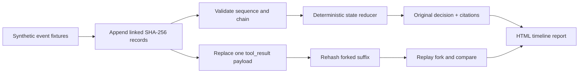

# Agent Replay Time Machine

**One tool result changes. Does the agent's incident decision change?**

An offline, deterministic incident replay debugger built around an append-only-looking **SHA-256-linked event log**. Record synthetic tool calls and results, reconstruct intermediate state, create a counterfactual fork by replacing one tool response, then compare outcomes and checksum changes in a standalone HTML timeline.

## Quick start

```bash
python -m replay_machine demo --out examples/replay_report.html --trace-out examples/trace.json
python -m unittest discover -s tests -v
```

Open [`examples/replay_report.html`](examples/replay_report.html). The supplied synthetic incident starts with a **critical backlog** and results in `escalate`. In the fork, the same tool's recorded response says conditions were normal, changing the rule-based decision to `monitor`. No external tool or LLM is called.

## Architecture



## What is implemented

- **Replay to any event count:** inspect unfinished tool calls and evidence accumulated so far.
- **Strict state machine:** one initial `start`, allowlisted tools, unique call IDs, correlated results, and no finalize while calls are pending.
- **Evidence-based outcome rules:** escalate on high/critical signals, investigate warnings, monitor normal evidence, and abstain without evidence. Citations point to recorded tool-result event IDs.
- **One-event counterfactual forks:** replace a recorded severity/summary without mutating the original log. Semantic payload differences are separated from expected downstream checksum differences.
- **Tamper checks:** every event hash depends on the previous event's hash and canonical JSON representation.

## Important limitations

This is a **deterministic rule-based agent simulator**. It does not execute LLM calls, replay external side effects, verify actual incident facts, or provide real-world causal inference.

A hash chain is **not an authenticated audit log**. Anyone capable of rewriting a log can recalculate the hashes. If a trusted head hash is stored independently, the chain helps detect mutation; production would additionally need durable immutable storage, independent signatures or trusted timestamps, privacy controls, and redaction.

The event trace uses synthetic fictional data. See [`DESIGN.md`](DESIGN.md) for invariants and follow-up engineering ideas.

MIT licensed.
